# Slack Wake Lock — macOS menü çubuğu uygulaması



Mac'i belirlenen saatlerde uyanık tutar, hareketsizlik sayacını sanal fare
hareketleriyle yeniler ve geçici bir şifre ekranı sunar. Slack masaüstü
uygulamasıyla kullanılabilir; çevrimiçi durumu garanti edilmez.

**macOS 13+ · Apple Silicon ve Intel · MIT lisansı · Türkçe arayüz**

Bağımsız bir projedir; Slack/Salesforce ile ilişkili değildir.

## Hazır uygulamayı indir

Bu reponun **Releases** bölümünden `Slack-Wake-Lock-1.0.0-macos-universal.zip`
dosyasını indir. ZIP'i açıp `Slack Wake Lock.app` uygulamasını Uygulamalar klasörüne kopyala ve
Erişilebilirlik izni ver. Xcode gerekmez. Otomatik kurulum istersen release
klasöründe `bash install.sh` çalıştırabilirsin.

Bu sürüm ad hoc imzalıdır; Apple noter onayı yoktur. macOS ilk açılışı
engellerse doğruladığın uygulama için **Gizlilik ve Güvenlik → Yine de Aç**
yolunu kullan. [Apple'ın açıklaması](https://support.apple.com/102445).

Kurulum, release ve yayınlama ayrıntıları: [RELEASE.md](RELEASE.md).
Yerel dosyalar, ağ bağlantıları ve izinler: [PRIVACY.md](PRIVACY.md).

**Geçici ekranın varsayılan PIN'i `123456`'dır ve kaynakta açıktır. Bu ekran
macOS'un güvenli ekran kilidi yerine geçmez.**

## Nasıl çalışır?

Slack Wake Lock mesai saatlerinde, bilgisayara 1 dakikadan uzun süre dokunmazsan fareyi
olduğu yerde sanal olarak kıpırdatır. Sayaç sıfırlanmazsa sonraki denemelerde
imleç 1 piksel gidip geri gelir. Slack'in çevrimiçi davranışı sürüme ve
ayarlara göre değişebilir; uygulama sistemin hareketsizlik sayacını yeniler.

- Sen bilgisayarı kullanırken hiçbir şey yapmaz. Yalnızca 1 dakikadan uzun süre dokunmadığında devreye girer.
- Slack'e tıklamaz, mesaj yazmaz ve Slack API'sini kullanmaz.
- Mesai saatlerinde ekranın kendi kendine kapanmasını ve Mac'in uyumasını engeller (pilde de).

> **Masaüstü uygulaması önerilir:** Tarayıcı sekmelerinin kendi etkinlik
> takibi ve arka plan kısıtlamaları vardır. Web sürümünde aynı davranış beklenmemelidir.

## Günlük plan (varsayılan ayarlar)

| Saat | Slack Wake Lock ne yapar? |
|---|---|
| 08:45–11:50 | Çevrimiçi tutar |
| 11:50–12:00 | Bırakır. Bilgisayarda değilsen Slack seni 12:00 civarında kendiliğinden uzakta gösterir |
| 12:00–13:00 | **Öğle molası:** dokunmaz |
| 13:00–17:50 | Çevrimiçi tutar |
| 17:50–18:00 | Bırakır. Slack seni 18:00 civarında uzakta gösterir |
| 18:00 sonrası | Sadece sen gerçekten çalışıyorsan, son hareketinden sonra 30 dk daha çevrimiçi tutar |
| Hafta sonu | Hiçbir şey yapmaz |

**Neden 10 dk erken bırakıyor?** Slack seni ancak 10 dk hareketsizlikten sonra uzakta gösterir. Slack Wake Lock da tam 12:00'de bıraksaydı, uzakta görünmen 12:10'u bulurdu. 10 dk erken bırakınca saat tam 12:00'de uzakta görünürsün.

**Cuma (isteğe bağlı):** Yeni kurulumlarda kapalıdır. `friday.enabled: true`
yapılırsa seçilen şehir için Diyanet hesaplama yöntemiyle aladhan.com'dan
vakit alınır. Mola ezandan **15 dk önce** başlar, **45 dk sonra** biter.
Çakışan molalar birleştirilir. İnternet yoksa yaklaşık hesap kullanılır.

**Molada çalışırsam ne olur?** Slack Wake Lock seni zorla çevrimdışı yapmaz, sadece kenara çekilir. Bilgisayarı kullanıyorsan Slack seni zaten çevrimiçi gösterir.

## Kaynaktan kurulum

Kaynak kodu derlemek için Xcode Command Line Tools gerekir (`xcode-select --install`).

1. **Slack masaüstü uygulamasını kur:** https://slack.com/downloads/mac (ya da App Store). Giriş yap ve Slack ayarlarında "bilgisayar açılınca başlat" seçeneğini açık bırak. İstersen Chrome'daki Slack sekmesini kapatabilirsin.
2. Bu klasörde terminalden:
   ```bash
   ./install.sh
   ```
   Kaynak klasöründe bu komut uygulamayı derler, `~/Applications/Slack Wake Lock.app`
   konumuna kopyalar, Mac açılınca otomatik başlatmayı ayarlar ve çalıştırır.
   Aynı betik release klasöründe çalıştırılırsa hazır uygulamayı kullanır.
3. **Erişilebilirlik izni ver** (zorunlu): *Sistem Ayarları → Gizlilik ve Güvenlik → Erişilebilirlik → Slack Wake Lock* anahtarını aç. Bu izin olmadan fare kıpırdatılamaz. Menü çubuğundaki simge ⚠️ olarak görünüyorsa izin eksik demektir.

> Güncelleme veya yeniden derleme sonrası Erişilebilirlik iznini yeniden vermen gerekebilir.

## Kullanım

Menü çubuğundaki simgeye tıkla:

| Simge | Anlamı |
|---|---|
| ⚡︎ (dolu) | Çevrimiçi tutuluyor |
| ⏳ | Mola ya da mesai bitişi yaklaşıyor, kenara çekildi |
| ☕︎ / ☾ | Öğle molası / Cuma namazı |
| ⚡︎ (boş) | Mesai dışında çalıştığın için çevrimiçi tutuluyor |
| ☾ zzz | Mesai dışı, hiçbir şey yapmıyor |
| ⏸ | Durduruldu |
| ⚠️ | Bir sorun var (izin eksik, Slack yüklü değil ya da ayar dosyası bozuk) |

- **⏸ Durdur:** "1 saat", "Bugünlük" (yarın kendiliğinden devam eder) ya da "Ben devam ettirene kadar" seçeneklerinden biri. Durdurulmuşken Mac normal davranır ve ekran kapanabilir.
- **▶︎ Devam et:** Durdurmayı kaldırır.
- **🔒 Geçici ekran kilidini aç:** Tüm monitörleri şifre ekranıyla kaplar. Açmak için **`123456`** yazıp **Enter**'a bas veya *Kilidi aç* düğmesine tıkla. Yanlış şifre ve Escape ekranı kapatmaz.
- **Cuma ezanı için şehir:** Şehri değiştirir. Türkçe karakter kullanmadan yaz (Istanbul, Ankara, Izmir…).
- **Mac açılınca otomatik başlat:** Otomatik başlatmayı açar ya da kapatır.
- **Slack Wake Lock'tan çık:** Bir sonraki açılışa kadar tamamen kapatır.

Menüde o günün planı, ne kadar süredir boşta olduğun ve son kıpırdatmanın saati de görünür. Ayrıntılı kayıt için *Günlüğü göster* seçeneğini kullan (`~/Library/Logs/Wakelock.log`).

### Geçici ekran kilidi

Geçici kilit, macOS oturumunu kilitlemeden masaüstünü örter; Dock ve menü çubuğu kaplamanın altında kalır. macOS'un bildirimleri "presentation mode" gerekçesiyle susturmasına yol açan kiosk/sunum ayarları kullanılmaz. Kaplama üstte kalır ve Slack banner'ları kendi önizleme alanında gösterilir. Normal uygulama değiştirme ve Spotlight kısayolları, Erişilebilirlik izniyle yalnızca kilit sırasında ayrı bir olay filtresinde engellenir. Ekran bağlı tüm monitörlerde gösterilir; monitör takılıp çıkarıldığında kaplama güncellenir.

Arka plan tam siyahtır. Pil yüzdesi ve **Şarj oluyor / Prize bağlı / Pille çalışıyor** bilgisi ekranda gösterilir; güç kaynağı değişince güncellenir. İlk **5 saniye** mevcut parlaklık korunur. Ardından desteklenen ekranlarda donanım parlaklığı en fazla **%5** seviyesine indirilir; zaten daha düşükse yükseltilmez. Fareyi oynattığında, tıkladığında veya klavyeyi kullandığında önceki parlaklık geri gelir; tekrar 5 saniye hareketsiz kalınca kısılır. Slack Wake Lock'un sanal fare hareketleri ekranı aydınlatmaz. Şifreyle açarken veya uygulama normal kapatılırken parlaklık geri yüklenir.

Donanım parlaklığı macOS'un denetleyebildiği ekranlarda değiştirilir. Desteklenmeyen harici monitörlerde siyah arka plan ve soluk yazılar kullanılır; fiziksel arka ışık değişmeyebilir. Ekran ve Mac açık kaldığı için pil tüketimi tamamen durmaz.

**Slack bildirimleri:** Geçici kilit açıkken macOS bildirim arayüzüne teslim edilen yeni Slack banner'larının son üçü sağ üstte gösterilir. Gönderen/başlık ve mesaj önizlemesi kullanılır; diğer uygulamalar filtrelenir. Mevcut **Erişilebilirlik** izni gerekir. İçerik yalnızca bellektedir, dosyaya veya günlüğe yazılmaz ve kilit açılınca silinir. Şifre girmeden görülebileceğini göz önünde bulundur.

*Geçici kilitte Slack için ek uyarı sesi* açıkken yakalanan yeni Slack bildiriminde macOS'un Glass sesi çalar. Normal Slack sesi de geliyorsa çift ses duymamak için menüden bu ek sesi kapatabilirsin. *Slack kilit bildirimi ve sesini test et* menüsü yalnızca Slack Wake Lock içinde örnek gösterir; gerçek bir Slack mesajı göndermez ve Slack'in bildirim teslimini test etmez.

Slack veya macOS bildirim göndermiyorsa, Odak modu bildirimleri susturuyorsa, banner'lar kapalıysa veya mesaj önizlemesi gizlenmişse Slack Wake Lock içeriği üretemez. Slack'te **Preferences → Notifications → Sound & appearance**, macOS'ta **Bildirimler → Slack → Bildirimlere izin ver / Bildirimler için ses çal** ayarlarını kontrol et. Önizleme, macOS'un Erişilebilirlik arayüzünde sunduğu banner yapısına bağlıdır; sürüm değişikliklerinde uyarlama gerekebilir.

Bu ekran açıkken Mac ve ekran uyanık tutulur, fare kıpırdatma **mola, mesai dışı ve duraklatma dahil** devam eder. Şifreyle açınca önceki çalışma planı ve varsa duraklatma tekrar geçerli olur. Ekranın zaman aşımı yoktur; yalnızca menüden sen açtığında devreye girer. Kilit durumu diske yazılmaz: Slack Wake Lock veya Mac yeniden başladığında **kendiliğinden açılmaz**. Slack Wake Lock'un mevcut otomatik başlatma ayarı bundan bağımsızdır.

**Bu özellik macOS'un güvenli ekran kilidi değildir.** Şifre uygulama kodunda sabittir. Zorla çıkış gibi sistem yollarıyla kaplama aşılabilir. Gerçek güvenlik gerektiğinde macOS ekran kilidini kullan. Gerçek ekran kilidi, kapağın kapatılması, ağ kesintisi veya Slack'in kendi durumu nedeniyle çevrimiçi görünme garanti edilemez; fare kıpırdatma için Erişilebilirlik izni gerekir.

Herhangi bir günün planını terminalden görmek için:
```bash
"$HOME/Applications/Slack Wake Lock.app/Contents/MacOS/Wakelock" --plan 2026-10-23
```

## Ayarlar

*Ayarları düzenle (config.json)* seçeneği `~/Library/Application Support/Wakelock/config.json` dosyasını açar. Kaydettiğin değişiklikler 15 sn içinde kendiliğinden uygulanır.

| Ayar | Varsayılan | Açıklama |
|---|---|---|
| `workStart` / `workEnd` | `"08:45"` / `"18:00"` | Çevrimiçi tutulacak mesai aralığı |
| `workDays` | `[1,2,3,4,5]` | 1 = Pazartesi … 7 = Pazar |
| `breaks` | Öğle 12:00–13:00 | Birden fazla mola eklenebilir: `{"name": "...", "start": "15:00", "end": "15:15"}` |
| `friday.city` / `friday.country` | `Istanbul` / `Turkey` | Ezan vaktinin alınacağı yer |
| `friday.minutesBeforeEzan` | `15` | Cuma molasının ezandan kaç dk önce başlayacağı |
| `friday.minutesAfterEzan` | `45` | Cuma molasının ezandan kaç dk sonra biteceği |
| `friday.enabled` | `false` | Cuma molasını ve vakit indirmeyi açmak için `true` yap |
| `holidays` | `[]` | Hiç çalışılmayacak günler, ör. `["2026-10-29"]` |
| `afterHoursGraceMinutes` | `30` | Mesai dışında çalışırken son hareketinden sonra kaç dk daha çevrimiçi tutulacağı. Kapatmak için `0` |
| `slackAwayAfterMinutes` | `10` | Slack'in uzakta gösterme süresi. Kıpırdatmanın molalardan kaç dk önce biteceğini belirler |
| `nudgeWhenIdleSeconds` | `60` | Kaç saniye dokunmazsan fare kıpırdatılır |
| `keepDisplayAwakeDuringBreaks` | `true` | Molalarda da ekran açık kalsın mı (aşağıdaki nota bak) |
| `launchSlackIfClosed` | `true` | Mesai başında Slack kapalıysa arka planda açılsın mı |
| `lockScreenSlackSound` | `true` | Geçici kilitte yakalanan yeni Slack bildirimi için ek Glass sesi çal |

## Bilmen gerekenler

- **Mac açık ve oturumun açık olmalı.** Mac kapalıyken, uykudayken ya da **kapağı kapalıyken** hiçbir program seni çevrimiçi gösteremez. Kapağı kapatırsan Mac uyur (şarja ve harici monitöre bağlı değilse). Mac'i yeniden açıp giriş yaptığında Slack Wake Lock kendiliğinden başlar.
- **macOS ekranını kilitlersen (⌃⌘Q ya da Touch ID tuşu) uzakta görünebilirsin.** Gerçek oturum kilidini Slack Wake Lock engellemez. Menüdeki *Geçici ekran kilidini aç* seçeneği ise oturumu açık tutarak masaüstünü kaplar; güvenlik farkı yukarıda açıklanmıştır.
- **Güvenlik:** Mesai saatlerinde ekran kendiliğinden kilitlenmeyeceği için masandan ayrıldığında Mac açık kalır. Ofiste bunu göz önünde bulundur.
- **Molalarda ekran:** `keepDisplayAwakeDuringBreaks: true` olduğunda molada da ekran açık kalır. Böylece mola bitince Slack Wake Lock seni güvenilir şekilde tekrar çevrimiçi yapar. `false` yaparsan molada ekran kapanıp kilitlenebilir, mola sonrasında da çevrimiçi olman sen bilgisayara dönene kadar gecikebilir.
- Kurulum, Slack için macOS'un "App Nap" özelliğini kapatır (`NSAppSleepDisabled`). Böylece arka plandaki Slack yavaşlatılmaz.

## Kaldırma

```bash
./uninstall.sh          # uygulamayı ve otomatik başlatmayı kaldırır
./uninstall.sh --all    # ayarları ve günlüğü de siler
```

## Dosyalar

- `Sources/main.swift`: menü çubuğu, çalışma planı ve uyanık tutma
- `Sources/TemporaryLock.swift`: geçici şifre ekranı ve çoklu monitör yönetimi
- `Sources/LockPower.swift`: pil bilgisi ve gecikmeli donanım parlaklığı kontrolü
- `Sources/SlackNotifications.swift`: Erişilebilirlik ile yalnızca Slack banner önizlemeleri; içerik bellekte tutulur
- `Sources/LockShortcutGuard.swift`: kiosk modu kullanmadan kilit sırasında uygulama değiştirme kısayollarını engelleme
- `build.sh`: `build/Slack Wake Lock.app` dosyasını derler
- `Assets/AppIcon.png` / `Assets/Wakelock.icns`: Slack renkleriyle hazırlanan uygulama ikonu; derlemede uygulama paketine eklenir
- `install.sh` / `uninstall.sh`: kurulum ve kaldırma
- `test.sh`: açık macOS oturumunda geçici kilit testleri (`bash test.sh`; kaplama kısa süre görünür)
- `release.sh`: universal uygulama, temiz kaynak arşivi ve SHA-256 listesi üretir
- `VERSION`, `LICENSE`, `PRIVACY.md`, `RELEASE.md`: sürüm, lisans, gizlilik ve dağıtım bilgileri

## Release hazırlama

```bash
bash test.sh
bash release.sh
python3 Tests/verify-release.py
```

`dist/` altındaki kaynak ZIP'ini açıp içindeki dosyaları kendi public
repona yükle. Uygulama ZIP'ini ve SHA-256 listesini GitHub Release'e ekle.
Derleme çıktıları, kullanıcı dosyaları ve sertifikalar `.gitignore` ile hariç tutulur.

## Lisans

[MIT](LICENSE). İkon bu proje için üretilmiştir; Slack'in renklerinden
esinlenir ve resmi Slack logosu değildir. Slack adının ve markasının hakları
ilgili sahiplerine aittir.
